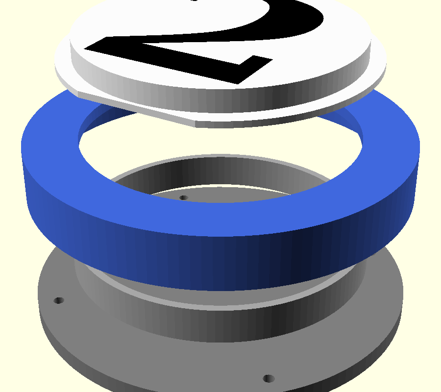

# Pool-ball body + "top hat" number insert: fit test

Checks the fit between the white/number insert (the "top hat") and the
coloured "ball" body before designing the full pager. Source:
`ball_fit_test.scad` (OpenSCAD, everything is a parameter).



## Concept
- **Ball** (coloured, one design for all pagers): face with a 72 mm opening,
  keyed pocket behind the face, screw bosses at the back. Prints **face down**.
- **Top hat** (white, swappable): hollow crown with a 0.8 mm face and the
  number; the crown passes through the opening and stands **2.5 mm proud**
  (this is what keys into the pager above). The brim is **D-shaped** (flat at
  6 o'clock) so the number is always upright.
- **Base**: screws into the ball with **counterbored (recessed) screws**; the
  **stacking recess** underneath takes the crown of the pager below, and the
  **touch sensor** goes in that recess.
- **Clamp ring**: holds the brim in its pocket (in the real pager the LED
  ring mount can do this).

## Parts (this test uses a shortened, 14 mm deep ball)
| File | Print | Notes |
|---|---|---|
| `hat_variant0.stl` | white, face down, **supports under the brim** (build plate only) | Crown 71.95 mm (0.05 mm smaller than the opening: your usual PLA fit). 1 notch on the brim |
| `hat_variant1.stl` | same | 71.90 mm, 2 notches |
| `hat_variant2.stl` | same | 71.80 mm, 3 notches |
| `number.stl` | black, as a second part of the hat (multi-material) | Full-depth inlay through the 0.8 mm face, so the number stays opaque |
| `ball.stl` | ball colour, face down | 100 mm OD, 72.0 mm opening |
| `base.stl` | any, recess side up (as exported) | Counterbored for M2.5 x ~10 mm self-tapping screws |
| `clamp.stl` | any | Loose ring |

Single-extruder alternative for the number: set `number_mode = "raised"`
(0.6 mm raised number, swap filament at that layer) and re-export the hat.

## What to check
1. Which hat variant passes through the opening with the fit you want.
2. Brim seats in the pocket only one way (number upright).
3. Crown height above the ball face (2.5 mm) looks right.
4. Two assemblies stack: the crown drops into the base recess easily
   (recess is deliberately looser: 0.4 mm on diameter).
5. Number size and font; light through the face with the LED ring behind.

## Key parameters
`white_od` 72, `ball_od` 100, `ball_face_t` 3, `protrude` 2.5,
`crown_clears_d` [0.05, 0.10, 0.20], `brim_w` 4, `brim_clear_d` 0.05,
`recess_clear_d` 0.4, `number_text` "2", `number_font` "DejaVu Serif:style=Bold".

## Re-exporting
```
openscad -D 'part="hat"' -D 'hat_variant=0' -o hat_variant0.stl ball_fit_test.scad
openscad -D 'part="number"' -o number.stl ball_fit_test.scad
openscad -D 'part="ball"'   -o ball.stl   ball_fit_test.scad
openscad -D 'part="base"'   -o base.stl   ball_fit_test.scad
openscad -D 'part="clamp"'  -o clamp.stl  ball_fit_test.scad
```
