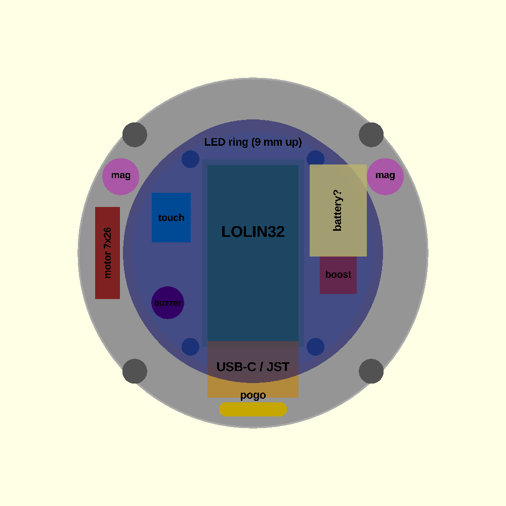
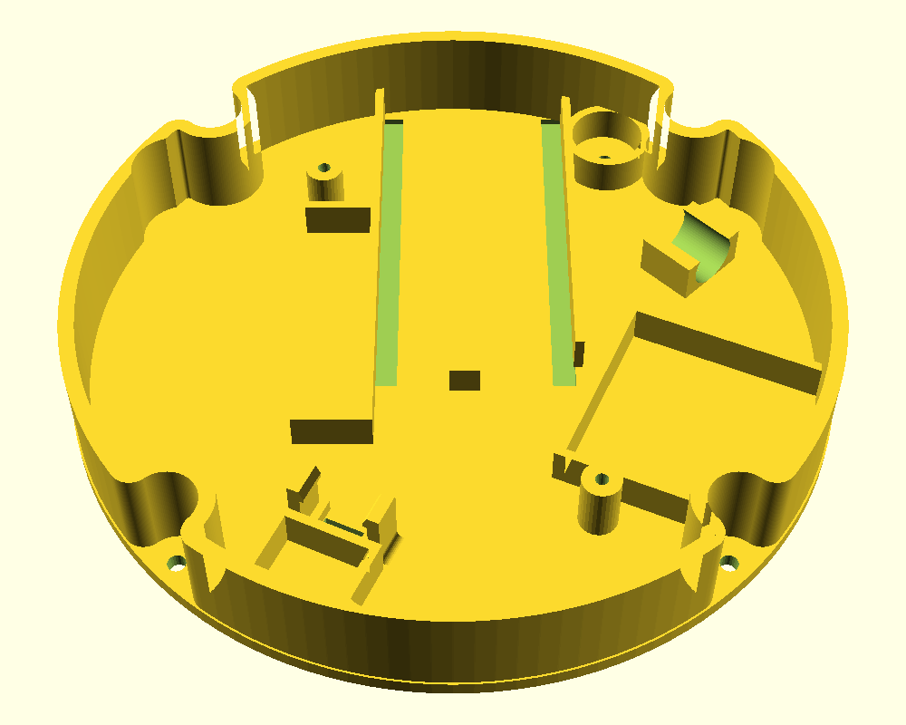

# Chassis layout sketch

`layout_sketch.scad` / `layout_sketch.png`: top view of the chassis plate
with component outlines, to check fit before designing mounts. Not a part.

Space (pager_shell_test defaults, ball 20.8 mm, LED ring at its original
height): plate ~98.8 mm across; **9 mm under the LED ring** (68 mm circle in
the middle), 13.8 mm outside it up to the brim. LED ring posts at
(+-17.6, +-26.4).

**Current layout (general only, not final)** is modelled directly in the
chassis (`pager_shell_test.scad`, "Component mounts" group); every position
and angle is a Customizer setting. `layout_sketch.png` above is the older
outline sketch.

Pockets: 1.2 mm walls (`pocket_wall`), 5 mm high (`pocket_h`), 0.3 mm
clearance round each part (`pocket_clear`); neighbours share walls. LED ring
posts at 1 and 7 o'clock removed (`ring_posts`), 11 and 5 o'clock kept.
Battery, boost and touch module: 3 walls (part + 2 x 1.2 mm wide, + 1.2 mm
toward the centre); the chassis clamp ring is the 4th wall. Each part's back
corners sit on the ring (`*_gap` moves it in). The LOLIN32 pocket is open at
the 12 o'clock end and shares its left wall with the battery.

| Part | Size (mm) | Placement |
|---|---|---|
| Battery 503035 | 35 x 30 x 5 | 9 o'clock, back on the clamp ring, `bat_y` 4 mm towards 12 o'clock; inner wall shared with the LOLIN32; top/bottom walls only 9 mm long from that wall (`bat_wall_keep`) so a longer/narrower battery fits by the chassis wall |
| LOLIN32 Lite | 49.6 x 25.7 | Placed automatically: left wall shared with the battery, top end against the clamp ring at 12 o'clock, 0.05 mm per side (`lolin_clear`); stop tab 4 wide at the pogo end, 9.5 mm from the battery-side wall |
| Boost (3-pin) | 10.5 x 11 | 205 deg (~7 o'clock), back on the clamp-ring wall (no pocket back wall; `boost_gap` moves it in) |
| Buzzer | 9.2 dia | On the wall beside the LOLIN32's 12 o'clock end, away from the battery (~31 deg, auto from `buzzer_a` = -1), sharing the LOLIN32's wall; sound hole through plate and base |
| Power switch | 8.75 x 5 x 4.5 | Against the boost pocket's front (centre-side) wall, which is its back wall (`switch_dx` slides it along); under the LED ring; riser pads, end clips 0.6 mm clear of the wall, slider slot through plate and base |
| Touch module | 24 x 24.3 | 117 deg (~4 o'clock), back on the clamp-ring wall (no pocket back wall; `touch_gap`), facing the centre |
| Vibration motor | 7 x 26 | Centre (32, 16), axis turned 45 deg towards the LOLIN32, one 8 mm clip, +0.1 mm on the diameter |

All heights fit under the LED ring (9 mm): LOLIN32 ~6, battery ~5, boost
~4, buzzer 5.8.
