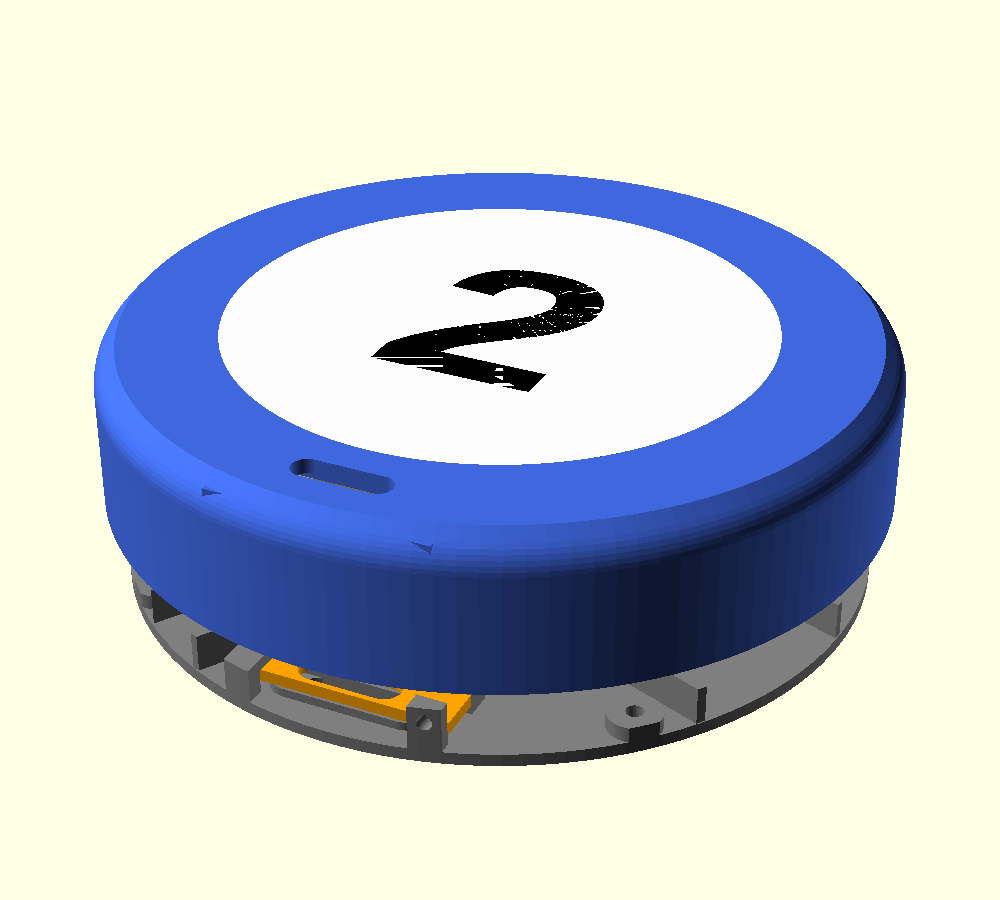
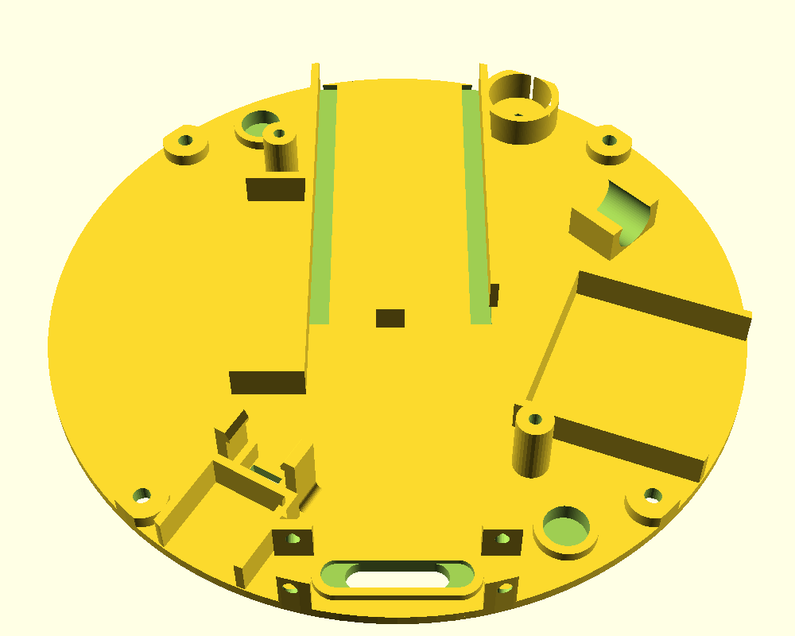
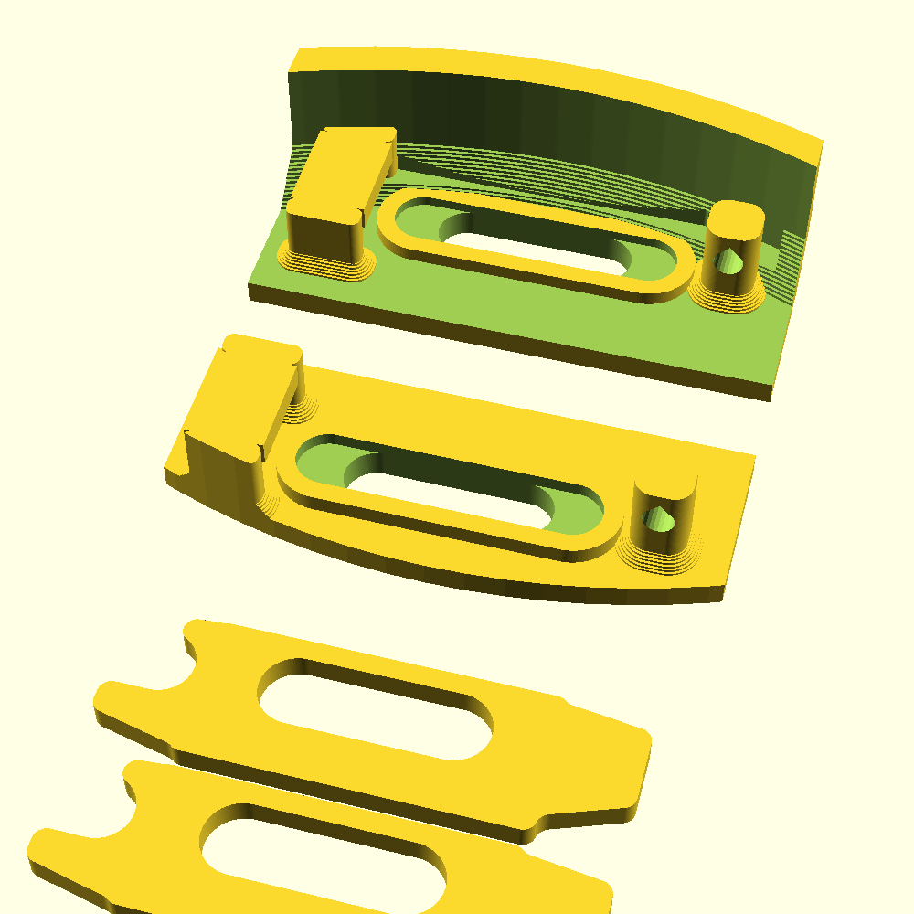

# Pager shell Rev 2

Rev 1 (`../pager_shell_test/`) is kept unchanged. **Not yet printed.**

Source: `pager_rev2.scad` (OpenSCAD, Customizer groups). Scripts:
`export_all` (parts for the number in `number_text`), `export_numbers`
(ball / white / number for 1-15 into `numbers/`).

## Parts

| Part | Print | Notes |
|---|---|---|
| `ball` + `white` + `number` | Top down, one object with 3 parts (AMS) | Load the three STLs together in Bambu Studio as one object; ball colour / white / black |
| `base` | Bottom down | Carries every component (Rev 1 chassis mounts) |
| `pogo_clamp` | Flat, x2 | One for the top connector, one for the bottom |
| `pogo_test` | As exported | Test print: the pogo corner of the ball (top down) and of the base, cut from the real parts, plus two clamps |

## Top
- Top 1.65 mm (`top_t`); 45 deg build-up in the inside corner (`corner_build`
  3 mm) against light leaking through the rounded edge.
- White circle 72 mm, 0.45 mm thick (`white_t`) over a light pocket
  (70 mm, `pocket_rim` 1 mm). Outside the pocket the white is backed by ball
  colour.
- Number 1.2 mm deep (`number_t`) from the top: inside the light pocket it
  stands as black relief behind the white so it doesn't glow.
- LED tops 6.5 mm below the underside of the white (`led_gap`; spacers can
  add to it). Ball height 20.8 mm as Rev 1.

## Stacking, magnets, pogo
- Nothing sticks out of the top or the bottom. Magnets (6 x 2.75) go in from
  the inside with 0.45 mm in front (0.9 mm between stacked magnets), at 60 and
  300 deg: with the pogo connector at 180 deg they form the alignment
  triangle. The battery sits over the 300 deg magnet boss on the base. Magnet
  bosses flare out 45 deg to the root (hill shape) against shearing.
- Pogo connectors at 6 o'clock (r 44, as Rev 1), top and bottom, faces
  flush. Each flange sits in a walled pocket; the walls stop 0.2 mm short
  (`pogo_press`) so the clamp presses the flange.
- Clamp: the 7 o'clock end (5 mm tongue) hooks under a latch bar (insert,
  then lever the clamp down); the latch window is 1 mm narrower on the wall
  side. The 5 o'clock end is forked round a single 3.5 x 3.5 mm post (tine
  2 mm on the centre side, 1 mm on the wall side); a ~9 mm piece of 1.75 mm
  filament goes through the post's 1.95 mm hole (teardrop, no support),
  pushed in from the centre, and lies across the tines.
- Clamp body 9 mm wide: 2 mm added on the centre side (the wall side is
  limited by the ball wall at the clamp's corners). Rounded corners, filleted
  inside corners, 45 deg tapers into both ends. The ball's corner build-up is
  cut back round the clamp (0.4 mm) so it fits under the curve. Post and
  latch legs have rounded edges and a 0.9 mm flare at the root. Both clamps
  are the same part.

## Base
- 1.65 mm plate, built up to 3.65 mm under each column for the M2 x 8 screw
  heads.
- Component mounts as Rev 1 (LOLIN32 tray and tab, battery stubs, boost,
  buzzer, touch, motor clip, switch), now placed against the ball wall
  instead of the old clamp ring, so they sit ~2 mm further out.
  Boost moved to 210.5 deg (clear of the pogo latch and the 7:30 column);
  touch at 111 deg (clear of the 4:30 column); motor moved to (29, 13) to
  clear the 60 deg magnet.
- LED ring posts 9.7 mm (free height under the ring).
- Switch riser pads from slider length - base: slider tip 0.5 mm up from the
  bottom (`switch_tip_recess`).

## Pogo latch test print (`pogo_test`)

Back: the ball's pogo corner (printed top down, with a stub of the wall).
Middle: the base's pogo corner (component mounts left out). Front: two
clamps. Fit both connectors: flange in its pocket, clamp end under the latch
bar, lever the clamp down over the post, push a 1.75 mm filament pin through.

