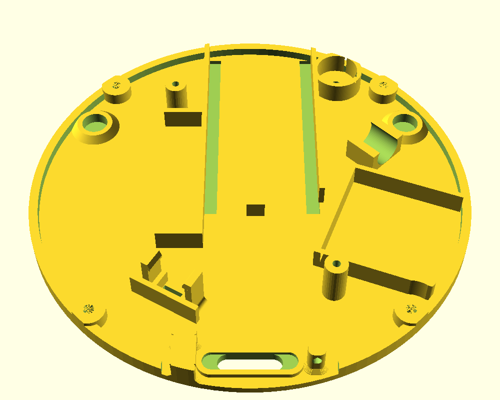
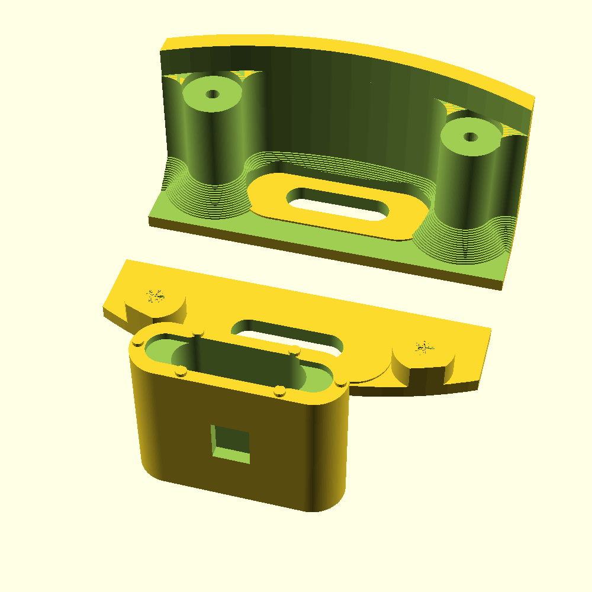

# Pager shell Rev 2

Rev 1 (`../pager_shell_test/`) is kept unchanged. **Not yet printed.**

Source: `pager_rev2.scad` (OpenSCAD, Customizer groups). Scripts:
`export_all` (every part, number from `number_text`), `export_numbers`
(white + number for 1-15 into `numbers/`; the ball and touch_mark are the
same for every number).

## Parts

| Part | Print | Notes |
|---|---|---|
| `ball` + `white` + `number` | Top down, one object with 3 parts (AMS) | Load them (and `touch_mark`) together in Bambu Studio as one object; ball colour / white / black. `ball` is the same for every number; `white_N` / `number_N` come from `export_numbers` |
| `touch_mark` | With the ball (4th part) | Ring on the top over the touch sensor, for its own colour |
| `base` | Bottom down | Carries every component (Rev 1 chassis mounts) |
| `pogo_tower` | Upright | Holds both pogo connectors, clamped between ball top and base |
| `pogo_test` | As exported | Test print: the pogo end of the ball (with the two columns either side, full height) and of the base, cut from the real parts, plus the tower |

## Top
- Top 1.65 mm (`top_t`); 45 deg build-up in the inside corner (`corner_build`
  3 mm) against light leaking through the rounded edge.
- White circle 72 mm, 0.45 mm thick (`white_t`) over a light pocket
  (70 mm, `pocket_rim` 1 mm). Outside the pocket the white is backed by ball
  colour.
- Number 1.2 mm deep (`number_t`) from the top: inside the light pocket it
  stands as black relief behind the white so it doesn't glow.
- LED tops 6.5 mm below the underside of the white (`led_gap`; spacers can
  add to it). Ball height 20.8 mm as Rev 1.

## Stacking, magnets, pogo
- Nothing sticks out of the top or the bottom. Magnets (6 x 2.75) go in from
  the inside with 0.45 mm in front (0.9 mm between stacked magnets), at 60 and
  300 deg: with the pogo connector at 180 deg they form the alignment
  triangle. The battery sits over the 300 deg magnet boss on the base. Magnet
  bosses flare out 45 deg to the root (hill shape) against shearing.
- Pogo connectors at 6 o'clock (r 44), top and bottom, faces flush, held by
  the **pogo tower**: a plain oval tube (22.4 x 7.1 x 14.75 mm). Each
  connector's flange sits in a pocket in the base / ball pad (1.05 / 1.05 mm
  deep), printed open side up so there are no overhangs. Corrections from
  test print 2 (`pogo_pocket_extra_base` / `_ball`, `tower_len_adj`,
  `col_len_adj`): faces were 0.85 (base) / 0.65 (ball) below the surface, so
  the pockets are that much shallower and the tower that much longer; the
  tower was 0.15 too tall (now -0.15); the screw columns were 0.10 short, so
  the base build-ups are 0.10 taller (ball key pockets 0.10 deeper).
  No crush bumps (`tower_rib_h` removed: the test only fitted without them).
- Each tower end sits in a collar (5.6 mm tall, 0.9 mm wall; raised 4 mm from 1.6 for alignment) on the base
  pad and on the ball pad: a plain snug fit, modelled with 0 clearance
  (`tower_fit`; 0.1 and 0.05 printed loose because the slicer's hole
  compensation opens the collar up). The snap bead tried before was too small to print
  (`snap_bead` = 0 now; the option is still there).
  Wire the two connectors together inside
  the tower (5 V and GND pass straight up the stack); a 2-wire lead to the
  electronics leaves through the slot on the centre side. The slot is 8 mm wide x
  11 mm tall (centred on the 14.75 mm tower), wide enough to solder the wires to
  the connector pins; the solid 1.9 mm at each end still holds the flanges. The
  same slot is cut through both collars (from 1.9 mm above the pad), because
  the taller collars would otherwise cover most of it.
- The support ledge, rim and corner build-up are cut away round the tower
  and collars (1.3 mm clear).
- Screw columns at 45 and 315 deg as before; the other two at 159.5 and
  200.5 deg, one each side of the tower (1.6 mm from its ends, 0.6 mm from
  the collars), so the screws there clamp it.

## Base support
- The base's screw build-ups stand 1 mm proud and key into pockets in the
  column ends (0.15 mm clearance), so the base can't rotate.
- A 2 mm ledge runs all round the ball wall at the column ends (45 deg above
  it, prints without support), and the base has a matching 2 mm rim round its
  edge up to the same height, so the base is supported all round. Parts that
  sat against the wall now sit against the rim (2 mm further in).
- The ledge and the rim are cut away round the pogo tower (1.3 mm clear).

## Base
- 1.65 mm plate, built up to 3.65 mm under each column for the M2 x 8 screw
  heads.
- Component mounts as Rev 1 (LOLIN32 tray and tab, battery stubs,
  buzzer, touch, motor clip, switch), now placed against the ball wall
  instead of the old clamp ring, so they sit ~2 mm further out.
  No 5 V boost (ring and buzzer on 3.3 V): the power switch keeps its place
  at ~7 o'clock with its own back wall;
  touch at 111 deg (clear of the 4:30 column); motor moved to (29, 13) to
  clear the 60 deg magnet.
- LED ring posts 9.7 mm (free height under the ring).
- Switch riser pads from slider length - base: slider tip sticks out 0.5 mm below the
  bottom (`switch_tip_recess`).

## Pogo tower test print (`pogo_test`)

The pogo end of the ball (printed top down, full height, with the two
screw columns either side), the matching piece of the base, and the tower.
Drop a connector into the pocket in each piece, snap the tower into the
base piece's collar, press the ball piece's collar over the top and screw
the two together: both connector faces should sit flush and not move.
`part = "pogo_section"` shows the assembled stack cut through the tower.
