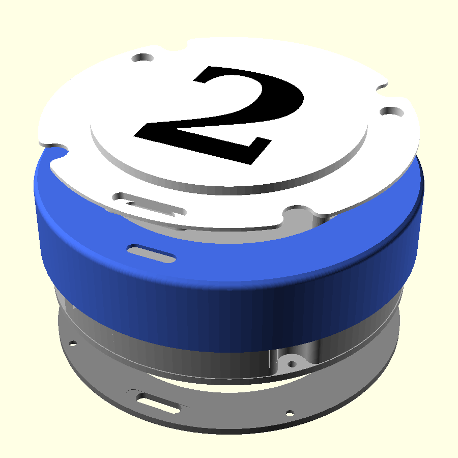

# Pager shell test (v15)

Pool-ball pager shell. Source: `pager_shell_test.scad` (OpenSCAD; open the
Customizer for grouped settings and dropdowns). To export one part: choose
`part`, press **F6**, wait for "Rendering finished", then **F7** (export
uses the last F6 render).



## v15 changes
- Switch clips broke at the base. The riser pads were fused to the inside
  of each clip arm, so the arm only bent above the pad top (~4.5 mm of arm
  instead of ~6.3). Pads now stop 0.6 mm short of the arms (`switch_pad_gap`).
- Clip arms back to 1.2 mm (`switch_clip_t`): 1.2 tested fine once the pads were separated.
- `clip_test` has three switch mounts with 1.2 / 1.6 / 2.4 mm arms
  (`test_switch_clip_ts`), labelled with the thickness.

## v14 changes
- Switch hooks about twice as strong: flat 0.6 mm lip at the tip
  (`switch_hook_t`) under the sloped lead-in, instead of a knife edge.
- Switch moved against the boost pocket's front wall, which is now its back
  wall (own wall removed in the chassis). Clips stop 0.6 mm short of that
  wall (`switch_wall_gap`) so they can flex. `clip_test` has a matching wall.

## v13 changes
- Motor clip +0.10 mm (tested best).
- Switch: body 4.5 mm, 0.2 mm longer opening (`switch_extra_w`), 0.6 mm
  lower (`switch_tip_below` 0.6: slider tip 0.6 mm below the plate, into the
  base slot), clips 5 mm wide, wall on the pogo side (`switch_wall`; 0.6 mm clear of each clip, top 1.5 mm below the body top), moved
  between the pogo and the LOLIN32 inside the LED ring (`switch_x/y`).

## v12 changes
- Motor: one 8 mm clip (was two 4 mm), bore +0.2 mm (`motor_clear`).
- LOLIN32: snug tray, 0.05 mm per side; top end against the clamp ring so
  it can't slide; stop tab 4 mm wide. Position follows the battery.
- Battery 4 mm further from the pogo (`bat_y`); buzzer on the wall between
  the 7:30 column and the battery.
- Power switch mount at the old buzzer spot: riser pads, end clips with
  hooks, slider slot through the plate and the base. `switch_h` (body
  height, sets the hook) and `switch_slot_w` are guesses: measure and set.
- `clip_test` part: switch mount + motor clips at +0.10 / +0.20 / +0.30 mm.

## v11 changes
- Lit face (`light_t`) 0.4 mm, ball face (`ball_face_t`) 2.6 mm to cut light
  bleed at the rounded edge, edge radius (`edge_r`) 5 mm.
- LED ring 1 mm lower: `led_depth` 7.8 (LED tops 7.4 mm below the lit face),
  `internal_h` 3 so the ball stays 20.8 mm. Plate to brim bottom: 13.2 mm.
- Chassis: touch module turned 3 deg counter-clockwise (`touch_a` 114) to
  clear the screw column; LOLIN32 tray side walls 4 mm shorter at the pogo
  end (`lolin_tray_cut`) with a stop tab at the board end (5 wide, 4 tall,
  2 thick, 9.5 mm from the battery-side inside wall: `lolin_tab_*`).
- Thicker face: magnet pocket now has a 0.25 mm cap below the brim; pogo
  flange pocket needs no tongue.

## v6 changes (more room inside, base no longer proud)
- **Hat brim 1 mm, sunk into a 1 mm pocket** in the back of the 3 mm ball
  face: face + brim = 3 mm (was 4.6). Still follows the column bumps.
  - The ball pogo flange shares that layer: the brim has a cut-out round it
    and a **tongue underneath** that presses the flange (slot for the back
    oval and wires).
  - The magnets pass through the brim; **caps underneath** hold them in.
- **Base is a 2 mm ring**: the egg stacking recess goes right through it and
  the **chassis plate is the recess ceiling**. Base 2 + plate 2 = 4 mm
  (was 5). The plate's underside holds the base's pogo flange and magnets.
- **Clamp ring 0.2 mm short** (`ring_relief`) so print variation (e.g. the
  supported brim underside) no longer pushes the base ~0.5 mm out.
- **Magnets at r = 43** (was 44) so their caps clear the clamp ring.
- **Counterbore 4.8 x 1.2 mm** (fits the 2 mm base).
- Result: inside height plate top -> face back = **10 mm** (was ~7.4) in
  the same 17 mm ball.

## v7 changes
- `egg_tip` **1 mm**; stacking fit `recess_clear_d` **0.1 mm** (was 0.2).
- Shell screws **M2 x 8 mm self-tapping**: pilot 1.7, clearance 2.3,
  counterbore 4.2 x 1.5 mm so the head sits fully below the base surface
  (0.5 mm of base under the head; measure your screw head and set
  `screw_head_d` / `screw_head_h`).
- LED ring screws **M2 x 6 mm self-tapping**; shortest post that takes them
  is `post_min` (= 6 - 1.6 PCB + 0.6 = 5 mm).
- **`internal_h`** (Body group): the FREE height for electronics under the
  LED ring, beyond the minimum. The ball height is now calculated:
  `ball_h = base_t + chassis_t + post_min + internal_h + ring_h + led_gap - protrude + face_t`
  At `internal_h = 0` the ball is 16.8 mm. Add to `internal_h` and the ball
  grows by the same amount. The console prints the result after F5/F6.

## Number
- `number_text` sets the digit; `number_scale` its size (fraction of the
  72 mm white circle).
- Font: **Liberation Sans Bold** (bold sans, same proportions as
  Arial/Helvetica, close to the pool-ball style). Bundled in `fonts/` with
  its licence (SIL OFL), so every PC renders it the same. DejaVu Serif Bold
  is also bundled. Changing font: put the .ttf in `fonts/`, add a
  `use <fonts/NAME.ttf>` line at the top of the .scad, set `number_font`, and
  set `digit_h_ratio` (digit height / text size) so the underline sits right.
- **6 and 9 get a curved underline automatically**, like pool balls
  (`underline` auto / on / off; `underline_style` arc / bar). Its width,
  thickness, gap and curve are fractions of the number height, so they scale
  with it. It's part of the black inlay.


## Making the full set (1-15)
- **Same for every pager:** `ball`, `chassis`, `base` (print each ball in its
  pool-ball colour). Export once with `export_all.bat`.
- **Per pager:** `hat` + `number`. **`export_numbers.bat`** (Windows) or
  `export_numbers.sh` writes `numbers/hat_1.stl` + `numbers/number_1.stl` ...
  `hat_15` + `number_15` (~7 s per number). Edit the list in the script to
  export only some. 6 and 9 get their underline automatically.
- `numbers/` is not committed (it changes whenever the design is tuned):
  re-run the script after changing anything.
- Two-digit numbers at `number_scale` 0.45: "15" is about 45 mm wide in the
  72 mm white circle.

## v10 changes
- **`brim_t` is now just the brim's thickness (default 2 mm)**; new
  **`brim_sink`** (1 mm) is how much of it sits in the pocket in the back of
  the ball face. Before, `brim_t` was also the pocket depth, so a 2 mm brim
  cut through the whole 2 mm face.
- **Magnet and pogo pockets are cut into the brim from its top, only as deep
  as each part sticks out** (magnet 2.25 mm, flange 1.8 mm with the defaults).
  Where the brim is too thin to leave `floor_min` (0.6 mm) under a part, a cap
  (magnets) or tongue (pogo) is added underneath, only as thick as needed.
  The console reports the sizes. At `brim_t` 2: caps 0.85 mm, tongue 0.4 mm;
  at 2.5: caps 0.35 mm, no tongue; at 2.9: neither.
- The chassis clamp ring shortens to meet the brim's bottom.
- Caps are now **`cap_wall` (2 mm) thick round the magnet pocket** (was a
  fixed 0.4 mm, which sheared off); the clamp ring is notched around them.
  `mag_pocket_d` (6.4) sets the magnet pocket diameter in the brim.

## v9 changes
- **Ball face 2 mm** (`ball_face_t`) and **`internal_h` 4 mm** by default:
  ball 20.8 mm tall, 14.8 mm inside (plate top to face back).
- **`light_t`** (new **Light** group): thickness of the white lit face only.
  Thicker adds material on the inside; the outside height doesn't change.
  The black number follows it (`number_back` = how far the number continues
  behind the lit face, 1.6 mm).
- **`led_depth`** replaces `led_gap`: LED tops measured from the TOP of the
  white face (6.8 mm = the old 6 mm gap with a 0.8 mm face). The console
  prints the actual LED-to-face gap.
- **No chamfers** on the crown edge or the base ring opening
  (`crown_chamfer`, `recess_chamfer` = 0).
- **`base_pogo_extra`** (0.2 mm): more room for the base connector's flange
  in the chassis pocket. The pocket ceiling is a short 3.9 mm bridge, so it
  doesn't need supports; block supports there if the slicer adds them.
- With the thinner face the magnets stand 1.15 mm proud of the face back:
  the brim caps and the pogo tongue resize automatically.

## v8 changes
- **Connector sizes from the fit test:** body hole 13.15 x 3.9, flange
  pocket 19.2 x 3.9, face body 1.9, flange 0.9, so the connector face sits
  flush. The flange now ends 0.2 mm short of the face back, so the hat's
  brim gets a 0.2 mm presser there (automatic); the chassis pocket follows
  the base connector's depth the same way.
- **`export_all.bat` (Windows) / `export_all.sh`**: export all five parts as
  separate STLs in one go, using the values saved in the .scad.
- The hat stays **one piece** (crown + brim + number inlay).

## Printing the hat and number together
`hat.stl` and `number.stl` share the same origin. In the slicer, add both
**in one step** (select both files) and answer **yes** to "load as a single
object with multiple parts"; then set the number's filament to black.

## Assembly (from the back of the ball)
1. Pogo connector (flat contacts) into the ball face.
2. Magnets into the ball's pockets, same pole towards the face.
3. Hat in from the back: egg through the opening, brim into its pocket
   (tongue over the pogo flange, caps over the magnets).
4. LED ring onto the chassis posts.
5. Base: pogo connector (spring pins) and magnets pressed in from the
   underside.
6. Chassis plate onto the base (its pockets take the base pogo flange and
   magnet tops), then both into the ball; 4 M2 x 8 mm self-tapping screws up
   through base and plate into the columns.

## Parts
| File | Print | Notes |
|---|---|---|
| `hat.stl` | white, face down, slicer supports under the brim | Tongue + caps print on top of the brim |
| `number.stl` | black, second part of the hat | 2.4 mm deep inlay |
| `ball.stl` | ball colour, face down | 104 mm OD, 20.8 mm tall at `internal_h` = 4 |
| `chassis.stl` | any, plate on the bed | Plate underside is visible in the stacking recess |
| `base.stl` | any, underside on the bed | 2 mm ring |

## Pogo connector
Measured: 2 mm oval face body, 1 mm flange, 1 mm oval back body (4 mm total).
- Faces sit **flush**: 2 mm of plastic in front of the flange, then a **1 mm
  flange pocket from the back**; the 1 mm back oval sticks out of the back.
- Oval hole 13.45 x **4.3** mm in the model (this printer prints holes about
  0.1 mm small: 4.5 printed 4.4, so 4.3 should print ~4.2).
- Ball connector: flange in the brim layer, pressed by the **brim tongue**.
  Base connector: flange pressed by a pocket under the **chassis plate**.
- Ball = flat contacts (top of the pager), base = spring pins (underside).
  When stacked both faces are flush, so the gap is ~0 and the pins compress
  flush.

## Magnets (6 x 2.75 mm)
- **Ball:** pockets from the back with **0.4 mm** of plastic hiding the
  magnet on the face (a small pad behind the face gives the depth). Slide in
  and glue (hole 6.05 mm).
- **Base:** **pressed in** from the underside, flush (hole 6.0 mm, prints
  ~5.9 for a press fit).
- **Polarity:** install **every magnet with the same pole facing the top of
  the pager** (e.g. mark the north pole and always put it up). Then each
  pager's base magnets attract the ball magnets of the pager below.

## Check
1. Hat in the egg opening: only goes in one way, number upright.
2. Crown 1.5 mm proud; number size; more lit white area.
3. Pogo faces flush in ball and base; slot fit at ~4.2 mm printed.
4. Clamp bar holds the connector; wires fit through.
5. Two assemblies stack: egg drops in, magnets pull it down, pogo contact
   on both pins (meter).

## Tuning the stacking fit
- `recess_clear_d` (default 0.2 mm on diameter): how much bigger the base
  recess is than the crown below. Smaller = snugger, better rotation lock.
- `egg_shift` / `egg_small_d`: how pronounced the egg is. A subtler egg
  needs a tighter `recess_clear_d` to still lock the orientation.
- `recess_chamfer` (0.8) and `crown_chamfer` (0.4): lead-ins that guide a
  tight fit together. Only `base` and `hat` change when these change.

## Re-exporting
```
for p in hat number ball base brim_clamp pogo_clamp; do
  openscad -D "part=\"$p\"" -o $p.stl pager_shell_test.scad
done
```
