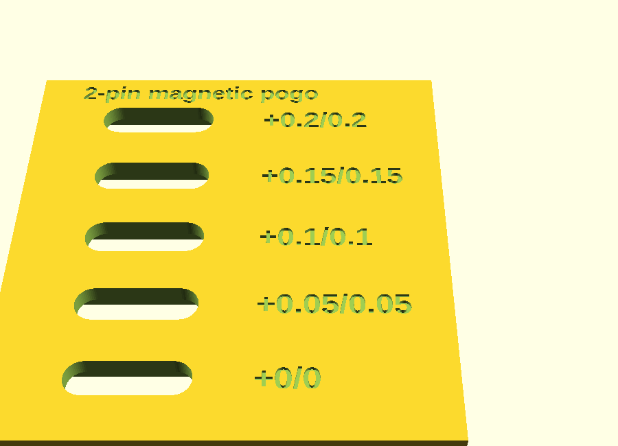

# Connector fit tester

Generic fit test for the pogo / magnetic charging connector (or any future
connector with a body and a mounting flange). Source: `pogo_fit_test.scad`.

- One plate, one slot per clearance. Each slot holds the connector the way
  the pager does: **face flush with the top**, body through a hole, flange
  in a pocket from underneath.
- Labels: `+body/flange` clearance in mm, added to both length and width.
- **Defaults = the original measured connector**: 2-pin magnetic pogo,
  stadium (rounded-end) body 13.15 x 4.0 mm, 2.0 mm in front of the flange,
  flange 19.2 x 4.0 x 1.0 mm. Default clearances 0, 0.05, 0.10, 0.15, 0.20.
- Print **as exported** (top up, pockets on the bed). 48 x 51 x 3 mm.

## Another connector
In the Customizer, **Connector (real sizes)** group: set `body_shape` /
`flange_shape` (`stadium` = rounded ends, `rect` = rounded rectangle with
`body_r` / `flange_r`, `flange_shape = none` for no flange), the sizes, and
`face_body` (body height in front of the flange: this is the plate
thickness that makes the face flush). Set `connector_name` for the label.

## Using the result
Copy the best fit into `enclosure/pager_shell_test/pager_shell_test.scad`
("Pogo connector" group):
- `oval_hole_l` = `body_l` + body clearance, `oval_hole_w` = `body_w` + body clearance
- `flange_pocket_l` = `flange_l` + flange clearance, `flange_pocket_w` = `flange_w` + flange clearance

The shell's current values (13.45 x 4.3) were sized before XY compensation
was corrected, so expect them to come down after this test.
