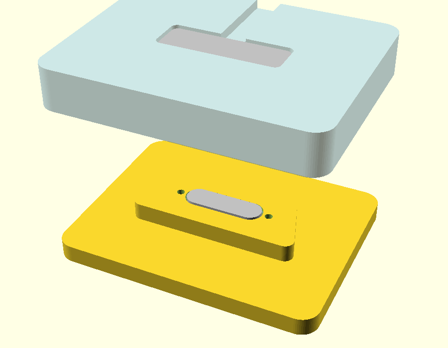

# Pogo connector + keystone fit test

Two small coupons that stack like two pagers, to check the magnetic pogo
connector fit, its protrusion, and the keystone that sets orientation.
Source: `pogo_key_test.scad` (OpenSCAD, every dimension is a parameter).



| File | What it stands in for | Contents |
|---|---|---|
| `pogo_key_top.stl` | Top of a pager (and the dock) | Raised trapezoid **keystone** with the **flat-contact** half; flange recessed from underneath; wire groove |
| `pogo_key_bottom.stl` | Underside of the pager above | Matching keystone **recess** with the **spring-pin** half (protected inside the recess); flange recessed from the inside; wire groove |

Both STLs are oriented to print with the flange side on the bed (no
supports). The trapezoid only mates one way round.

## Proposed arrangement
- **Spring pins** on the pager **underside**, inside the recess (protected
  when the pager is set down on a desk).
- **Flat contacts** on the **keystone on top** of every pager and on the dock.
- In the real pager the keystone sits **off-centre in the coloured border**,
  so it also sets the rotation of the whole pager.

## Parameters to tune (top of the .scad)
| Parameter | Default | Notes |
|---|---|---|
| `oval_l`, `oval_w` | 13.15, 4.0 | Measured |
| `oval_clear` | 0.25 | Hole clearance per side; raise if the oval won't pass |
| `body_depth` | 2.0 | Flange face to oval face (measured) |
| `flange_l`, `flange_t` | 19.2, 1.0 | Measured |
| `flange_w` | 6.0 | **Not measured yet**: flange's short dimension |
| `flange_hole_outside` | 17.44 | Measured, outside to outside |
| `flange_hole_d` | 1.6 | **Not measured yet** |
| `protrude_flat` | 0.2 | Flat contacts above the keystone top |
| `protrude_pins` | 0.4 | Pin face below the recess ceiling |
| `seat_gap` | 0.2 | Extra recess depth so the connector faces meet before the plastic bottoms out |
| `key_long`, `key_short`, `key_depth`, `key_h` | 28, 22, 12, 3 | Keystone shape |
| `key_clear` | 0.3 | Recess clearance per side |

Plastic between flange and outer face = `body_depth` - protrusion, so a
bigger protrusion means thinner plastic over the flange.

## Test
1. Press each connector half in from the flange side; fix with small
   self-tapping screws in the pilot holes, or glue.
2. Stack the coupons: check the keystone only fits one way, the magnets
   pull the faces together, and the plates sit close (gap about `seat_gap`).
3. Meter continuity across the joined connector, both pins.
4. Adjust protrusion / clearances and re-export.

## Re-exporting
```
openscad -D 'part="top"' -o pogo_key_top.stl pogo_key_test.scad
openscad -D 'part="bottom"' -o pogo_key_bottom.stl pogo_key_test.scad
```
