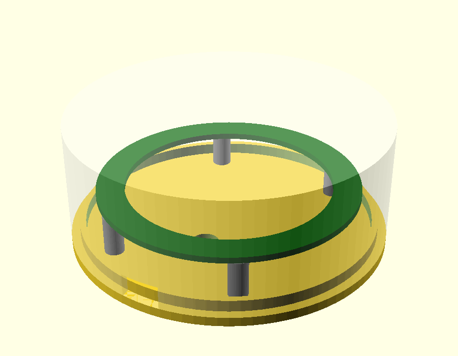

# LED ring diffusion test rig

Tests how far the 16-LED ring (68.2 mm OD) should sit below a 0.8 mm white
face for an even glow. Source: `ring_test.scad` (OpenSCAD, parametric).



## Parts
| File | Print | Notes |
|---|---|---|
| `ring_test_cup.stl` | 1, **white**, already oriented **face down** | The 0.8 mm face is the first 4 layers at 0.2 mm. Wall notch for the cable |
| `ring_test_base.stl` | 1, any colour | M2 nut traps underneath, centring lip on top, cable hole |
| `ring_test_spacers.stl` | 1 plate: 4 each of 5, 10, 15, 20, 25 mm | Tubes for M2 bolts |

## LED-to-face gap per spacer
Ring PCB + LEDs measured at 2.5 mm.

| Spacer | Gap | M2 bolt length (approx.) |
|---|---|---|
| 5 mm | 22.5 mm | 10 mm |
| 10 mm | 17.5 mm | 14-16 mm |
| 15 mm | 12.5 mm | 20 mm |
| 20 mm | 7.5 mm | 25 mm |
| 25 mm | 2.5 mm | 30 mm |

Bolt length = ring PCB + spacer + base (2.4 mm) + nut (~1.6 mm).

## Assembly
1. Drop 4 M2 nuts into the traps under the base.
2. Bolt down through the ring's holes, the spacers and the base into the nuts.
   LEDs face **up**.
3. Feed the 3 wires (DI, 5V, GND) through the base cable hole.
4. Drop the cup over the base; the wall notch can line up with the cable.
5. Run `pager_alert_test` (`t`, then `a`) and compare gaps.

## Notes
- Ring holes are ~2.0 mm; an M2 bolt (1.9 mm measured) just passes.
- Hole spacing was entered as **outside edge to outside edge** (37.24 x
  54.8 mm), giving centres 35.24 x 52.8 mm. If the holes don't line up, set
  `hole_cx` / `hole_cy` to the measured centre-to-centre values and re-export.

## Re-exporting STLs
```
openscad -D 'part="base"' -o ring_test_base.stl ring_test.scad
openscad -D 'part="cup"' -o ring_test_cup.stl ring_test.scad
openscad -D 'part="spacers"' -o ring_test_spacers.stl ring_test.scad
```
