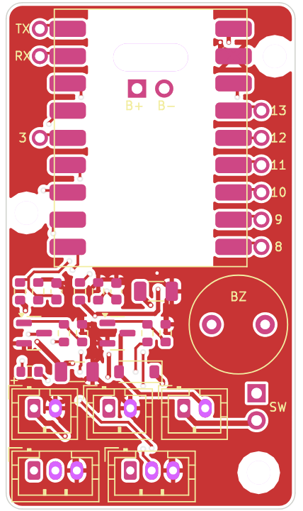
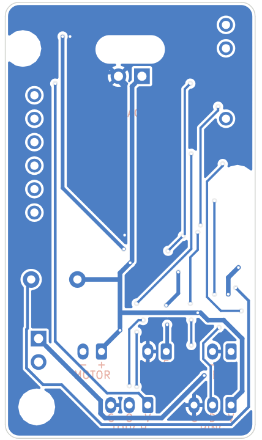

# Pager carrier board (ESP32-S3 SuperMini) — draft

**Status: laid out and routed (27 x 47.2 mm, 2 layers), DRC clean. Not ordered,
not tested. SuperMini row spacing and B+/B− pad position are still unmeasured.**


| Top | Bottom (seen from below) |
|---|---|
|  |  |

## Files and how to rebuild
- `design.py`: parts and every connection (single source for schematic and board).
- `schematic.py` → `schematic.svg` / `schematic.png`.
- `build_pcb.py`: outline, footprints, placement, nets → `carrier_s3.kicad_pcb`.
- `route_pcb.py`: scripted grid router (Freerouting was not available), GND pours
  on both layers, writes `drc_report.txt`. Needs numpy + scipy.
- `export_fab.sh`: Gerbers + drill → `fab/carrier_s3_gerbers.zip`, plus
  `fab/bom_jlc.csv` and `fab/cpl_jlc.csv` for JLCPCB assembly.
- `render.sh`: `pcb_top.png` / `pcb_bottom.png` (needs node + playwright).

```
python3 build_pcb.py && python3 route_pcb.py && sh export_fab.sh && sh render.sh
```
Open `carrier_s3.kicad_pcb` in KiCad 7+ to inspect or edit by hand.

## Board notes
- Rules: 0.2 mm clearance, 0.25 mm signal / 0.3–0.5 mm power tracks,
  0.6/0.3 mm vias, 0.3 mm to the edge; within standard JLCPCB/PCBWay limits.
- SuperMini soldered flat by its castellated edges onto long pads (tolerate
  about ±1.5 mm of row-spacing error). No top copper under its body.
- Its B+/B− pads are underneath: wires go down through the slot to the B+/B−
  holes (J6).
- Unused pins (TX, RX, GP3, GP8–GP13) each go to a 0.9 mm solder hole at the
  board edge, labelled.
- Connectors: JST-PH 2.0 vertical. Their holes also take wires directly. J1
  battery: pin 1 (square pad, `+` on top silk) = battery +. **Check against your
  battery plug before soldering a connector** — the latch makes it one-way.
- Buzzer: 5 mm pin spacing, pins either way round. Switch: two wire holes.
- 3 × M2 holes (2.2 mm) with copper kept 2 mm from centre for the screw head.
- JLCPCB assembly: top side only, all basic parts (LCSC numbers checked on
  lcsc.com / jlcpcb.com, Nov 2026). Check part rotations in JLC's placement
  preview before paying.

## Circuit
- Battery (J1) → power switch SW1 → **VBAT**: SuperMini B+ (short wire up
  through the board), LED ring, buzzer, motor, battery divider.
- Pogo (J5, from the pogo tower) **5 V** → SuperMini 5V pin (its charger
  charges the battery) and the dock divider.
- SuperMini **3V3** → touch module only.
- Buzzer and motor: low-side AO3400A MOSFETs, 100 Ω gate resistor, 100 kΩ
  pull-down; Schottky across the motor.
- Pins: dock GP1, battery GP2, touch GP4, ring GP5, buzzer GP6, motor GP7.

## Still to confirm before ordering
1. SuperMini: row-to-row spacing and B+/B− pad position (measure one board).
2. Battery plug polarity against J1.
3. Hole positions against the Rev 2 base columns (enclosure not yet changed).
