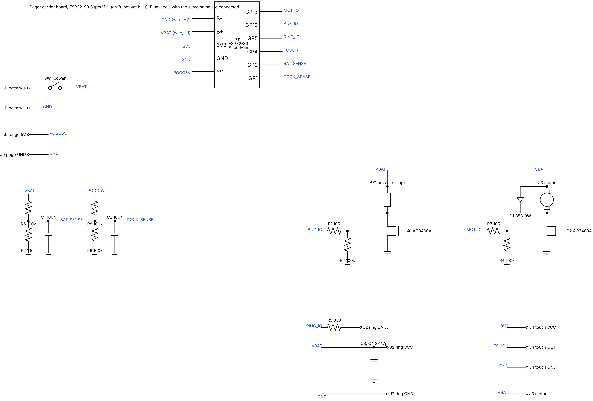

# Pager carrier board (ESP32-S3 SuperMini) — draft

**Status: laid out and routed (24 x 60.4 mm rectangle, 2 layers), DRC clean. Not ordered,
not tested. SuperMini row spacing and B+/B− pad position are still unmeasured.**



| Top | Bottom (seen from below) |
|---|---|
|  |  |

## Files and how to rebuild
- `design.py`: parts and every connection (single source for schematic and board).
- `schematic.py` → `schematic.svg` / `schematic.png`.
- `build_pcb.py`: outline, footprints, placement, nets → `carrier_s3.kicad_pcb`.
- `route_pcb.py`: scripted grid router (Freerouting was not available), GND pours
  on both layers, writes `drc_report.txt`. Needs numpy + scipy.
- `export_fab.sh`: Gerbers + drill → `fab/carrier_s3_gerbers.zip`, plus
  `fab/bom_jlc.csv` and `fab/cpl_jlc.csv` for JLCPCB assembly.
- `render.sh`: `pcb_top.png` / `pcb_bottom.png` (needs node + playwright).

```
python3 build_pcb.py && python3 route_pcb.py && sh export_fab.sh && sh render.sh
```
Open `carrier_s3.kicad_pcb` in KiCad 7+ to inspect or edit by hand.

## Board notes
- Rules: 0.2 mm clearance, 0.25 mm signal / 0.3–0.5 mm power tracks,
  0.6/0.3 mm vias, 0.3 mm to the edge; within standard JLCPCB/PCBWay limits.
- Plain rectangle, as wide as the SuperMini (24 mm). The SuperMini lies
  sideways along the top: USB-C end flush with the left edge (plug not
  blocked), antenna end flush with the right edge. No copper (pour, tracks, vias) on
  either layer under the antenna end (`ANT_LEN` = 5 mm, an estimate: measure)
  or in the corner just below it. All pins are on the board.
- Soldered flat by its castellated edges onto long pads (tolerate about
  ±1.5 mm of row-spacing error). No top copper under the middle of its body;
  a 2 mm strip inside each pad row is used to get the pins out.
- Its B+/B− pads are underneath: wires go down through the slot to the B+/B−
  holes (J6).
- Unused pins (TX, RX, GP3, GP6–GP11) each go to a 0.9 mm solder hole at the
  board edge, labelled on the bottom.
- Connectors: JST-PH 2.0 vertical, labelled on the top: pin names over the
  pins (`+ -`, `V D G`, `V O G`) and the connector name above them. Their
  holes also take wires directly. J1 battery: + is the RIGHT pin (pin 2,
  round pad), ground the left (square pad), to match the battery plug with
  its tab facing the top of the board. **Check against your battery plug before soldering a
  connector** — the latch makes it one-way.
- Buzzer (9 mm, 5 mm pin spacing) on the board, hand-soldered. Power switch:
  two wire holes (the switch stays in its mount in the base). Buzzer and motor
  are on GP12 / GP13 (away from the antenna end).
- 4 × M2 holes (2.2 mm) in the corners, 2.1 mm from both edges, copper kept
  2 mm from centre for the screw head. Strips above the SuperMini and below
  the connectors make room for them. The top-right one is near the antenna
  end (about 4 mm); no copper round it.
- Not fitted (pads kept, the hand-wired prototype works without them):
  C1/C2 (100 nF divider filters, 0603) and C3 (47 uF ring bulk cap, 1206,
  e.g. C96123: hand-solder it if the ring flickers or resets the board at
  high brightness).
- Assembled parts kept to 4 types to cut JLCPCB's per-part loading fee:
  100k, 330R (ring data and both MOSFET gates), AO3400A, B5819W.
- JLCPCB assembly: top side only, all basic parts (LCSC numbers checked on
  lcsc.com / jlcpcb.com, Nov 2026). Check part rotations in JLC's placement
  preview before paying.

## Circuit
- Battery (J1) → power switch SW1 → **VBAT**: SuperMini B+ (short wire up
  through the board), LED ring, buzzer, motor, battery divider.
- Pogo (J5, from the pogo tower) **5 V** → SuperMini 5V pin (its charger
  charges the battery) and the dock divider.
- SuperMini **3V3** → touch module only.
- Buzzer and motor: low-side AO3400A MOSFETs, 330 Ω gate resistor, 100 kΩ
  pull-down; Schottky across the motor.
- Pins: dock GP1, battery GP2, touch GP4, ring GP5, buzzer GP12, motor GP13.
  (Firmware: the S3 build must use these; the LOLIN build keeps its own pins.)

## Still to confirm before ordering
1. SuperMini: row-to-row spacing, B+/B− pad position, and how far the antenna
   reaches in from its end (`ANT_LEN`).
2. Battery plug polarity against J1.
3. Hole positions against the Rev 2 base columns (enclosure not yet changed).
