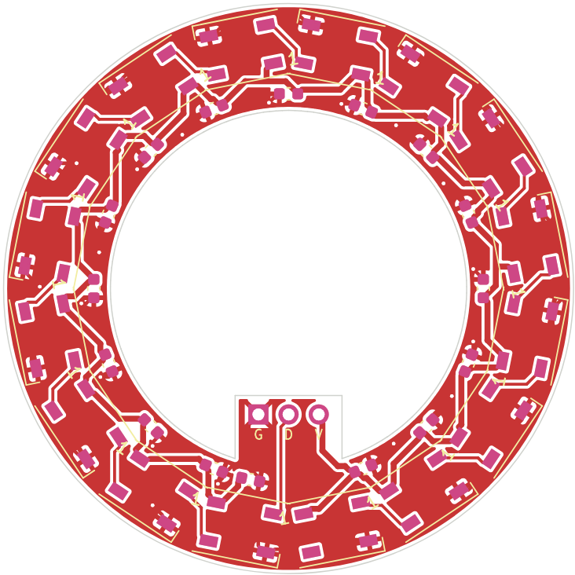
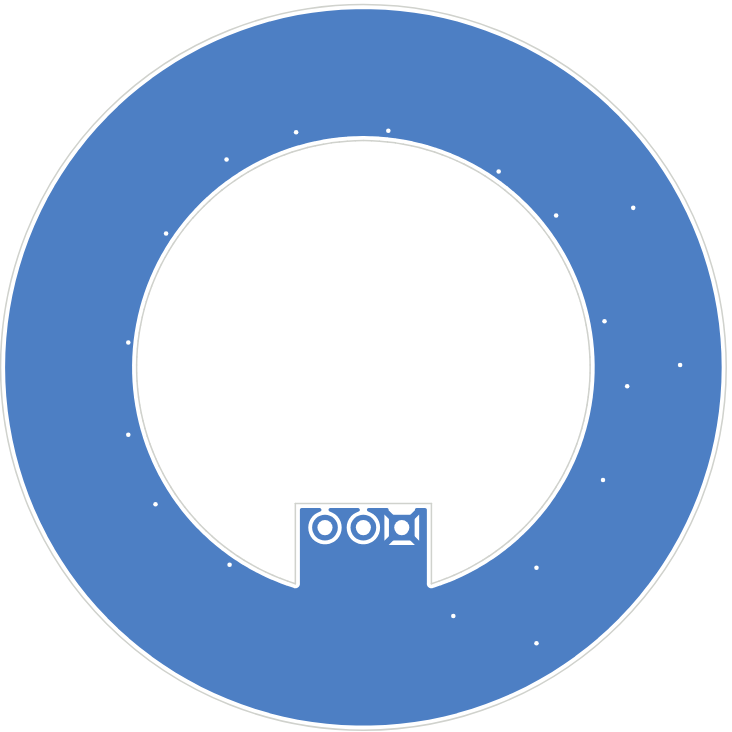

# 16-LED ring board (draft, for pricing)

**Status: laid out and routed, DRC clean (silkscreen notices only). Not ordered, not tested.**

| LED side | Back |
|---|---|
|  |  |

- 48 mm OD, 30 mm ID, 2 layers, 1.6 mm (same size as the 16-LED ring under consideration).
- 16 × XINGLIGHT XL-5050RGBC-2812B (LCSC C2843785, Extended), WS2812-compatible,
  3.5–5.5 V. KiCad's WS2812B footprint (pins 1 VDD, 2 DOUT, 3 GND, 4 DIN, same
  numbering as the XINGLIGHT datasheet); **check the LED orientation in JLCPCB's
  placement preview** — the datasheet's package drawing is an image only.
- 16 × 100 nF 0603 (C14663, Basic) on an inner circle, one per LED.
- Wire pads on a tab on the inside edge at 6 o'clock: **G D V** (GND, data in,
  VDD = VBAT), the same order as the carrier's RING connector. Data runs
  clockwise from LED 1 (just clockwise of the tab).
- No mounting holes: it sits in a tray in the base (to be designed).
- Bottom layer is a solid ground plane; LED numbers on the bottom silk.

Rebuild: `python3 build_ring.py && python3 ../carrier_s3/route_pcb.py led_ring16.kicad_pcb && sh export_fab.sh && sh render.sh ring_top.png ring_bottom.png`

Order files: `fab/led_ring16_gerbers.zip`, `fab/bom_jlc.csv`, `fab/cpl_jlc.csv`.
