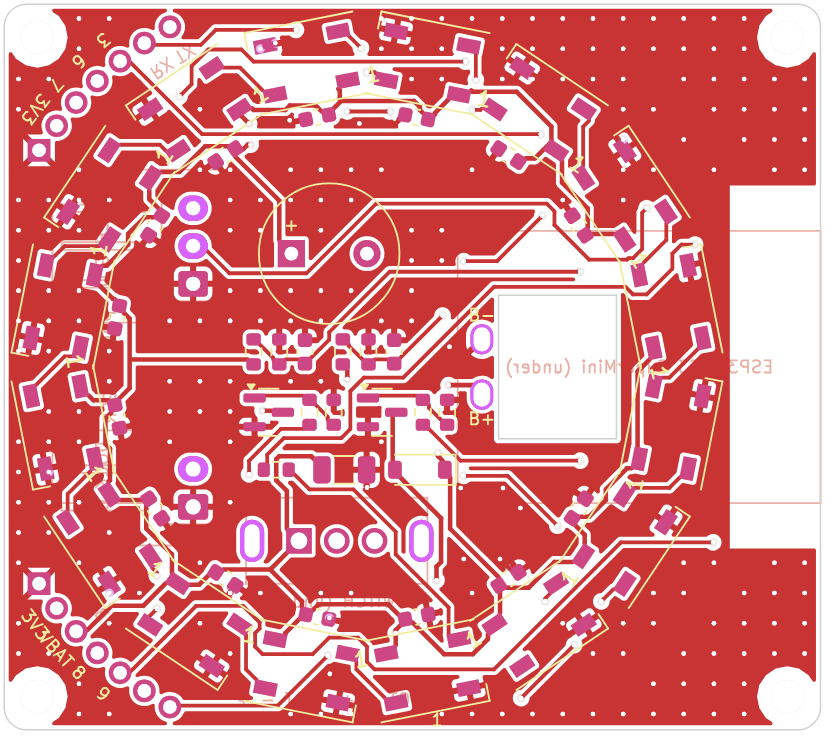

# Combined pager board (16 LEDs + ESP32-S3 SuperMini) — draft

**Status: placed, routed, GND stitched; DRC has no clearance or unconnected errors
(remaining: silkscreen overlaps/clipping and 5 single-spoke thermals). Not ordered, not tested.**

| Top | Bottom (seen from below) |
|---|---|
|  |  |

54 x 48 mm, 2 layers, M2 holes in all 4 corners (layout D from `layout_study.py`).

- **Top:** 16 × XINGLIGHT XL-5050RGBC-2812B (r 20.5 mm ring) with a 100 nF cap beside
  each, except the two LEDs beside the cut-out (no room; neighbours' caps are close).
  Buzzer (9 mm, through-hole) and the small parts inside the ring.
- **Under:** SuperMini flat on castellated pads, antenna end at the right edge (no copper
  there); B+/B− soldered from the top through 1.1 × 1.6 mm plated oval holes; 9.5 mm-wide
  cut-out from 2.7 mm off its USB end for its underside parts. Touch (XH-3) and dock
  (XH-2) right-angle connectors, plugs in from the left edge. SS12F44 switch (slider
  down; end-leg spacing 11.2 mm is an ESTIMATE, slotted). Battery and motor wire pads.
- **Spare pins** on an arc outside the LED ring: top-left TX RX 3 6 7 3V3 GND,
  bottom-left 11 10 9 8 VBAT 3V3 GND (labels on both sides where they fit).
- Connectors: pin 1 = GND (square), power last.

Pins: dock GP1, battery GP2, touch GP4, LEDs GP5 (via 330 Ω), buzzer GP12, motor GP13.

## Rebuild
```
python3 build_main.py
ROUTE_SKIP=GND ROUTE_FIRST=U1 ROUTE_MARGIN=0.08 \
  ROUTE_WIDTHS='{"VBAT": 0.3, "BAT+": 0.4, "POGO5V": 0.3, "MOT_-": 0.3}' \
  python3 ../carrier_s3/route_pcb.py pager_main.kicad_pcb
python3 ../carrier_s3/stitch_gnd.py pager_main.kicad_pcb 2.0
python3 ../carrier_s3/join_gnd.py pager_main.kicad_pcb
sh export_fab.sh && sh render.sh pcb_top.png pcb_bottom.png
```
Routing takes a while (randomised retries). GND is carried by the pours on both layers,
~200 stitching vias, and a few short tracks added by `join_gnd.py`.

## JLCPCB
`fab/pager_main_gerbers.zip`, `fab/bom_jlc.csv`, `fab/cpl_jlc.csv` (top-side assembly:
LEDs, caps, resistors, MOSFETs, diode). Hand-soldered: SuperMini, switch, buzzer, XH
connectors. **Check LED orientation in JLC's placement preview** (XINGLIGHT package
drawing is an image only).

## Still to confirm
1. Switch end-leg spacing (11.2 mm assumed).
2. Antenna length (5 mm kept copper-free).
3. Base/ball redesign to fit this board (holes, slider slot, connector access).
