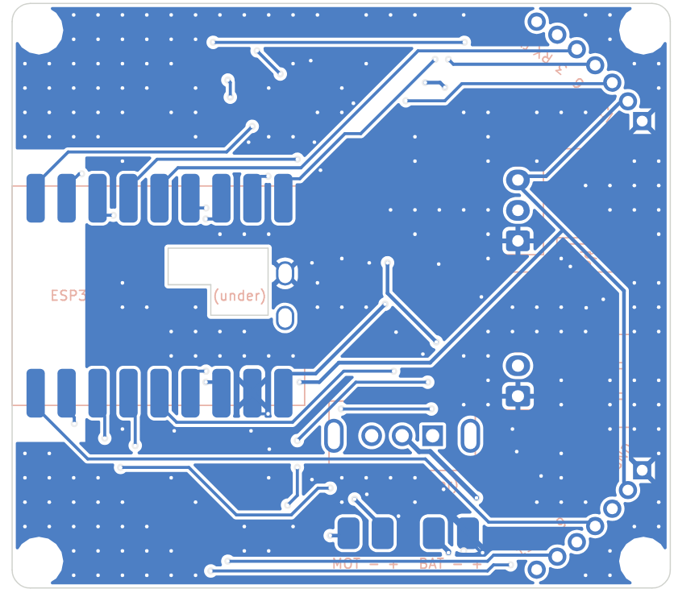

# Combined pager board (16 LEDs + ESP32-S3 SuperMini) — draft

**Status: placed, routed, GND stitched; DRC has no clearance or unconnected errors
(remaining: silkscreen overlaps/clipping and 1 single-spoke thermal). Not ordered, not tested.**

| Top | Bottom (seen from below) |
|---|---|
|  |  |

54 x 48 mm, 2 layers, M2 holes in all 4 corners (layout D from `layout_study.py`).

- **Top:** 16 × TUOZHAN TZ-5050S2RGB-5V-I4-H1 (LCSC C26167850, allowed in JLC Economic PCBA; the XINGLIGHT part was Standard-only), evenly spaced (22.5°) on a 20.5 mm radius,
  ring turned 19.75° so every LED keeps its own 100 nF cap beside it, clear of the cut-out.
  SMD buzzer MLT-8540H (C95298, 8.5 mm, passive: firmware drives GP12 with 2.7 kHz PWM)
  with flyback diode D2, and the small parts inside the ring; all JLC-assembled.
- **Under:** SuperMini flat on castellated pads, antenna end at the right edge (no copper
  there); B+/B− soldered from the top through 1.1 × 1.6 mm plated oval holes; an
  L-shaped cut-out only where the module's underside parts are (measured: 3.0–11.2 mm
  from the USB end, incl. 0.5 mm clearance). GND pour (no tracks) allowed under the module. Touch (XH-3) and dock
  (XH-2) right-angle connectors, plugs in from the left edge. SS12F44 switch (slider
  down; end-leg spacing 11.2 mm is an ESTIMATE, slotted). Battery and motor wire pads.
- **Spare pins** on an arc outside the LED ring: top-left TX RX 3 6 7 3V3 GND,
  bottom-left 11 10 9 8 VBAT 3V3 GND (labels on both sides where they fit).
- Connectors: pin 1 = GND (square), power last.

Pins: dock GP1, battery GP2, touch GP4, LEDs GP5 (via 330 Ω), buzzer GP12, motor GP13.

## Rebuild
```
python3 build_main.py
ROUTE_OPTIONAL=GND ROUTE_FIRST=U1 ROUTE_MARGIN=0.08 \
  ROUTE_WIDTHS='{"VBAT": 0.3, "BAT+": 0.4, "POGO5V": 0.3, "MOT_-": 0.3, "GND": 0.25}' \
  python3 ../carrier_s3/route_pcb.py pager_main.kicad_pcb
python3 ../carrier_s3/stitch_gnd.py pager_main.kicad_pcb 2.0
python3 ../carrier_s3/join_gnd.py pager_main.kicad_pcb
sh export_fab.sh && sh render.sh pcb_top.png pcb_bottom.png
```
Routing takes a while (randomised retries). GND gets tracks where they fit (routed last,
best effort), plus pours on both layers, ~200 stitching vias and `join_gnd.py` for any
piece left over. Check the DRC report for `via_dangling` after stitching: a via can land
in a pour sliver that the fill then drops (remove it from the file, refill).

## JLCPCB
`fab/pager_main_gerbers.zip`, `fab/bom_jlc.csv`, `fab/cpl_jlc.csv` (top-side assembly:
LEDs, caps, resistors, MOSFETs, diode). Hand-soldered: SuperMini, switch, buzzer, XH
connectors. **Check LED orientation in JLC's placement preview** (XINGLIGHT package
drawing is an image only; same 5050 4-pin WS2812B pinout).

## Checking before ordering
- `python3 check_netlist.py` compares every pad's net with `design_main.py` (independent of
  the generator).
- `print/top_1to1.pdf` and `print/bottom_1to1_seen_from_below.pdf`: print at 100 % (no
  "fit to page"), check the board outline measures 54 x 48 mm, then lay the real SuperMini,
  switch and XH connectors on them (pin rows, B+/B- holes, cut-out, switch legs).
- In JLC's placement preview: LED pin 1, buzzer +/-, diode stripes, MOSFETs.

## Still to confirm
1. Switch end-leg spacing (11.2 mm assumed).
2. Antenna length (5 mm kept copper-free).
3. Base/ball redesign to fit this board (holes, slider slot, connector access).
